# Midnight–Ethereum bridge

Ethereum-to-Midnight transfers retain the Snowbridge beacon/receipt verifier,
native issuance and Compact escrow/consumer flow. Midnight-to-Ethereum transfers
can use direct BEEFY signatures or the [Hyperbridge profile](../hyperbridge/README.md).

```mermaid
flowchart LR
    E[Ethereum deposit] --> B[Snowbridge receipt proof]
    B --> M[Midnight native issuance]
    M --> C[Compact consumer and escrow]
    C --> R[Committed retirement]
    R --> Q[Snowbridge outbound message]
    Q --> H[Bounded cumulative message tree]
    H --> L[Midnight BEEFY tip leaf]
    L --> P[Unmodified Hyperbridge SP1 program]
    P --> S[Unmodified SP1Beefy consensus contract]
    S --> A[MidnightHyperbridgeClient stores exact leaf]
    A --> G[Gateway checks message inclusion and nonce]
    G --> U[Ethereum release]
    U --> B
```

The `hyperbridge-poc` build retains up to 64 outbound message hashes, including
retry attempts. Merkle pairs are sorted as required by the existing Gateway.
Empty blocks preserve the root. A later authenticated tip therefore covers an
older message without requiring Hyperbridge to expose its internal MMR root.
The adapter accepts only exact leaves proven through the upstream contract;
Gateway MMR-path arguments must be empty for this profile. Its separate message
proof authenticates the selected message against the cumulative root.

The original direct-signature build retains its per-block message commitments.
Both profiles require a fresh development deployment. Hyperbridge upstream
sources, published ELF and Succinct verifier are pinned and checked for changes.
